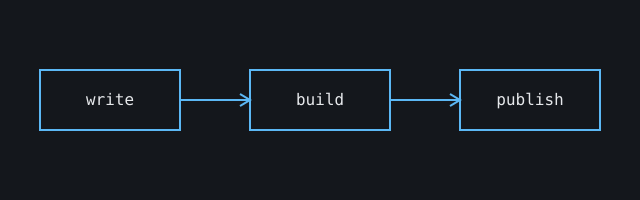

This is the first post. Every post is a Markdown file in `src/content/blog`, and the folder or file name becomes its URL.

## Why a personal site

A place to write things down, share what I learn, and keep it <mark>in one spot I own</mark>.

> Writing is thinking. To write well is to think clearly.

## What to expect

- Notes from building software
- Deep dives on tools and architecture
- Occasional short posts

```ts
function greet(name: string): string {
  return `Hello, ${name}!`;
}
```


