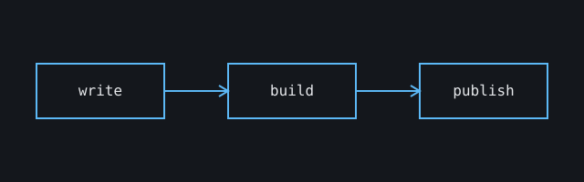

This post is a cheat sheet. It has `draft: true`, so it shows in `pnpm dev` and never in the built site.

## Text

**Bold**, _italic_, ~~strikethrough~~, `inline code`, [a link](https://astro.build), and <mark>highlighted text</mark>.

> A blockquote for callouts or quotes.

1. Ordered
2. List

| Column | Another column |
| ------ | -------------- |
| Tables | scroll sideways on small screens |

## Images

Put the file next to the post and reference it relatively. Astro optimizes it at build time.



With a caption:

<figure>
  
  <figcaption>A caption under the image</figcaption>
</figure>

## GIFs and short clips

Prefer MP4 or WebM over GIF: smaller and sharper. Put files in `public/media/` and use:

```html
<video src="/media/demo.mp4" autoplay loop muted playsinline></video>
```

For a clip with controls:

```html
<video src="/media/demo.mp4" controls preload="metadata"></video>
```

## YouTube and other embeds

```html
<iframe
  src="https://www.youtube-nocookie.com/embed/VIDEO_ID"
  title="Video title"
  loading="lazy"
  allowfullscreen
></iframe>
```

## Code

```ts
export const add = (a: number, b: number) => a + b;
```
